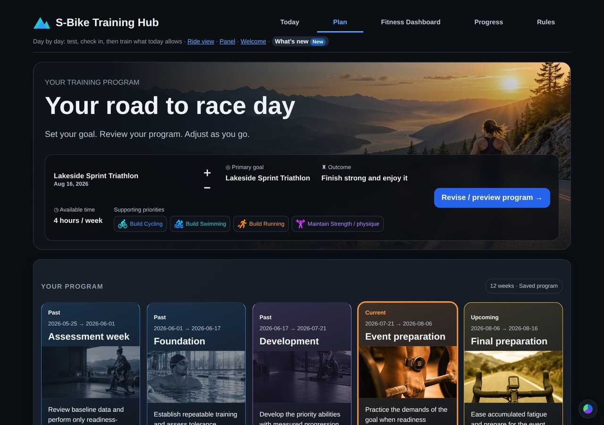
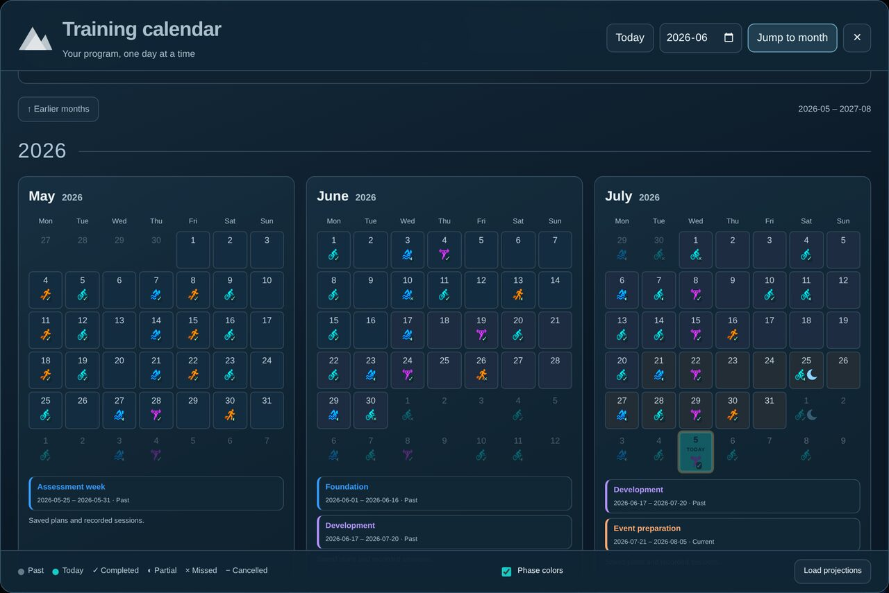
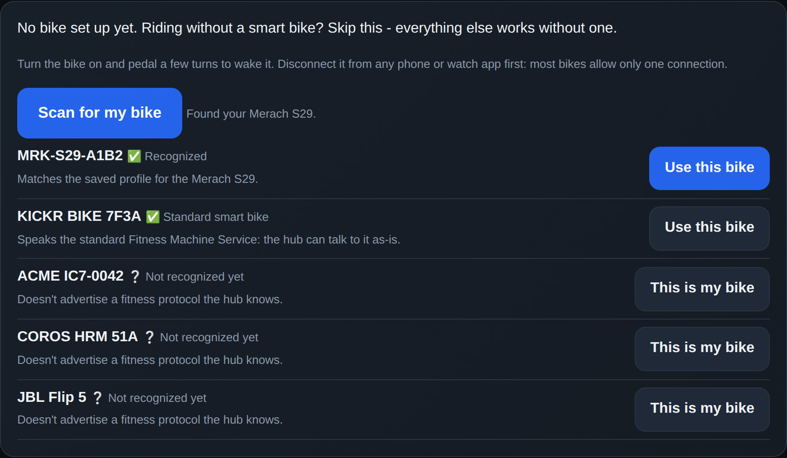

# S-Bike Training Hub

**Your training, organized. Your AI assistant, informed. You just train.**

A free training hub for cycling, swimming, running and strength that runs on your own computer (macOS, Windows or Linux). It keeps the record: what you planned, what you did, how hard it was, how you felt and what you missed and why. It hands that to your AI assistant, so the two of you can plan each week around how your body is actually responding. No subscription, no account, and it works with or without a smart bike.

<p align="center"></p>

<p align="center"><a href="https://www.strava.com/clubs/s-bike-training-hub"></a></p>

**Current version: app 1.12.0** with MCP 1.12.0 · [what's new](CHANGELOG.md) · [community on Strava](https://www.strava.com/clubs/s-bike-training-hub)

## What it does

- **Sets you up through your AI assistant:** your basics, a quick health check, what you do now and what you're aiming for, one question at a time.
- **Plans in two passes:** a season of placeholder sessions toward your goal, then each coming week's actual workouts from how the last one went. You preview every change before it's saved.
- **Plans a program toward your goal:** test week, foundation, development, event preparation, taper and race week. You preview every change before it's saved.
- **A training calendar** of the whole program, three months at a time, with every day's planned and recorded sessions.
- **Daily and weekly check-ins** built on standard sports-science questionnaires: Hooper (fatigue, sleep, stress, soreness), pain by body site, session effort on the CR-10 scale, and the OSTRC overuse questionnaire.
- **Workouts for every sport,** written in plain text with live previews: cycling power workouts, run/walk and interval runs, swim sets with send-offs, and strength sessions. Or import a photo or PDF of a written workout.
- **Your watch data:** import `.fit` and `.tcx` files from COROS, Garmin and others, or have your assistant fetch them. Bike and watch recordings of the same ride count once.
- **Improvement beyond volume:** pace or power against heart rate for each session, matched with your closest earlier session, with the day's air temperature if you turn that on.
- **A Fitness Dashboard:** recorded energy and work, where the work went in your body, swim history by stroke, lifting records and strength estimates.
- **Your rules,** in plain sentences: *"I can't do pull ups"*, *"No barbell deadlifts"*. Every workout and every assistant follows them.
- **A smart-bike bridge** (tested on the Merach S29): ERG workouts, virtual gears, hills turned into resistance, 3D routes and ride games, and sharing the bike with your watch and apps like Kinomap.
- **Ride modes (games) on the bike:** the hub runs game packs on its own built-in game engine. A game reads your live power, cadence and speed, sets the hills, and is calibrated to your own FTP, so the fun part is also the workout. Escape moves like sprinting or leaning come from your pedalling, a tilted tablet, or your camera (head and shoulders only, on your device). The hub runs only packs signed by the publisher and unchanged since signing.
- **An AI assistant connection (MCP):** Claude Desktop, Claude Code or any MCP app can read your record and plan with you, using the same operations as the app's buttons.

<p align="center"></p>

The [user guide](docs/guide.md) tours every page.

## Set it up

### 1. Install

**The one-line way** (macOS, Windows or Linux; needs [uv](https://docs.astral.sh/uv/getting-started/installation/)). This installs the whole hub and connects it to your assistant:

```bash
claude mcp add --scope user s-bike-hub -- uvx s-bike-training-hub@latest
```

For **Claude Desktop**, add this to its config file (Settings → Developer → Edit Config), then restart Claude:

```json
{ "mcpServers": { "s-bike-hub": { "command": "uvx", "args": ["s-bike-training-hub@latest"] } } }
```

If Claude Desktop can't find `uvx`, put its full path in `"command"` (run `which uvx` to see it). `@latest` makes each start check for a new version.

Then ask your assistant: *"Set me up with S-Bike Training Hub."* It starts the hub for you (at <http://127.0.0.1:8729>) and walks you through setup. Updates arrive automatically: `uvx` runs the latest release each time.

- **Start the app yourself:** `uvx --from s-bike-training-hub s-bike-hub`
- **Maps and route planning (optional, large):** `uvx --from s-bike-training-hub s-bike-hub-maps`
- **Your data** lives in your own data folder, never in the app: macOS `~/Library/Application Support/S-Bike Hub`, Windows `%APPDATA%\S-Bike Hub`, Linux `~/.local/share/s-bike-hub`.
- **A smart bike on macOS:** start the app once from Terminal (`uvx --from s-bike-training-hub s-bike-hub`) so macOS can ask for Bluetooth permission. Everything except live bike control works without it.

**From GitHub** (the full source, with setup scripts and the Desktop launcher). You need **Python 3.11+**.

**macOS** (everything, including the bike bridge, menu-bar icon, route planner and 3D maps):

```bash
git clone https://github.com/JHarp199345/S-Bike-Training-Hub.git
cd S-Bike-Training-Hub
./setup.sh              # everything, with a smart bike and maps
./setup.sh --no-maps    # the bike bridge without route maps
./setup.sh --no-bike    # no smart bike: the coach, training records, lifting and the dashboard
```

**Windows 10/11** (download the repository as a ZIP, or clone it, then in PowerShell in that folder):

```powershell
powershell -ExecutionPolicy Bypass -File setup.ps1           # the hub and the bike bridge
powershell -ExecutionPolicy Bypass -File setup.ps1 -NoBike   # no smart bike
```

**Linux:**

```bash
./setup-linux.sh             # the hub, the bike bridge and map tools (needs BlueZ: sudo apt install bluez)
./setup-linux.sh --no-maps   # skip the route planner and 3D maps
./setup-linux.sh --no-bike   # no smart bike
```

Setup creates the Python environment, installs what it needs and makes a launcher: **S-Bike Hub** on your Desktop on macOS and Windows, `./s-bike-hub.sh` on Linux. Your browser opens the hub at <http://127.0.0.1:8729>, starting with the **welcome page**. A GitHub install keeps your data in its own folder, as it always has.

- **Maps:** on Linux, route planning also needs Java, and map downloads for your region ask first. On Windows, maps aren't set up yet.
- **Testing:** installing and the simulated bike are tested on all three systems on every change. A real bike and watch have been tested on macOS only.

### 2. Tell it about you

The easiest way: ask your connected assistant to set you up (the welcome page has a prompt to copy). It asks for your basics, runs a short health check, asks about your sports, what you do now and what you're aiming for, then builds your program with you. You approve every step.

No assistant? On the welcome page, open **No assistant? Set up by hand**: your sports and experience, body weight, gender and heart rates, your running, and your rules (plain sentences that steer every workout; see [Rules](docs/guide.md#rules)). Then **Build my program**: the hub drafts a starter program that you preview and edit before applying.

### 3. Connect your AI assistant (optional, recommended)

The hub keeps the record; your assistant plans with you. It works with any app that supports MCP servers.

- **The one-line install** above already connects it.
- **Claude Desktop (bundle):** download the `.mcpb` bundle (MCP 1.12.0) from the [releases page](https://github.com/JHarp199345/S-Bike-Training-Hub/releases), then **Settings → Extensions → Advanced settings → Install extension**. Leave the hub address at `http://127.0.0.1:8729`.
- **Claude Code:** `claude mcp add --scope user s-bike-hub -- "$PWD/.venv/bin/python" "$PWD/mcp_server.py"` (on Windows: `.venv\Scripts\python.exe`).
- **Other MCP apps:** point them at `mcp_server.py` with the `.venv` Python.

The assistant has to run on the same computer as the hub. Web-only assistants such as ChatGPT can't reach it yet.

Then talk to it: *"How am I doing this week?"*, *"I missed Tuesday, I was sick"*, *"Plan next week around a work trip"*. Three built-in prompts:
- **daily-check-in:** your check-in, then the plan adjusted together;
- **predict-my-race:** a race prediction from your numbers, saved and refined as the program goes;
- **get-my-bike-working:** setting up a bike the hub doesn't recognize.

### 4. Connect your bike (optional)

On the welcome page, under **Your bike**: turn the bike on, pedal to wake it, disconnect it from any phone or watch app, and press **Scan for my bike**. Then click your bike in the list.

<p align="center"></p>

- **✅ Recognized** (like the Merach S29) or **✅ Standard smart bike** (most bikes made since about 2020): click **Use this bike**. Done.
- **❔ Not recognized yet:** click **This is my bike** and allow the hub to ask your assistant for help. Then open your assistant and type **get my bike working**. It confirms the bike with you, asks you to pedal at a couple of speeds, writes a bike profile (settings, never code), and runs a short guided check while you pedal.

The hub enforces the safety rules itself: no resets, no resistance 0, only small steps within the bike's range. If it can't work out the resistance command, the bike still works for power and cadence. Details: [bike setup](docs/bike-setup.md).

### 5. Get your watch data in

Use **Import watch workout** on Today for `.fit` or `.tcx` files. Choose the scheduled workout it belongs to, or **＋ New workout**, and preview before saving. With a watch connector (for example COROS), your assistant can do it: *"put my latest workout into the hub"*.

## Every day

1. **Check in** on Today or with your assistant: the daily questions, any pain, and a journal line if you want.
2. **Go through the "needs attention" list together.** Every check-in returns a short list for the coming week, most urgent first: a rule a session would break, a session over a limit, a test waiting for an answer, a missed session without a reason. Your assistant proposes the lightest fix, shows you the change, and applies it once you agree.
3. **Train** what today says, then report how it went.
4. **Weekly check-in:** a few minutes on how the week went.

## How the numbers work

The hub records facts and labels estimates as estimates.

- **Recorded work:** energy comes from the most reliable source available (bike power, then distance and gradient for runs and walks, then the watch). Each report freezes the load figures from the moment it was saved, so later formula changes can't rewrite your history.
- **Recovery and readiness come from your reports,** not from a fixed model. Running is guided by your recent reports and recorded exposure. Personalized recovery curves, learned from your own history, are in development and switched off by default until they're reviewed.
- **Nothing here is an injury prediction or medical clearance.** Formulas, sources and assumptions are in [how it works](docs/how-it-works.md) and [the coaching review](docs/coaching-review.md).

**Your data stays on your computer.** Nothing is uploaded unless you share it with an assistant or post to Strava yourself.

## Documentation

- [User guide](docs/guide.md): every page and feature.
- [How it works](docs/how-it-works.md): models, formulas and assumptions.
- [Coaching review](docs/coaching-review.md): how plan changes are checked.
- [Capacity planning](docs/capacity-planning.md), [strength capacity](docs/strength-capacity.md), [starter models](docs/starter-models.md).
- [Bike setup](docs/bike-setup.md), [personal music and video](docs/PERSONAL-MEDIA.md).
- [A 12-week program, day by day](docs/journey.md): a simulated athlete's season (recorded with an earlier version).
- [Changelog](CHANGELOG.md).

## Development

```bash
python tests/run_all.py     # every test; macOS-only tests are skipped elsewhere
```

Tests run on Linux, macOS and Windows in GitHub Actions on every push, installing with each system's setup script.

## Privacy

Your records stay on your computer. The only outside request the hub can make is an **optional** air-temperature lookup for outdoor sessions, off until you turn it on: it sends a place rounded to about 10 km and a date to [Open-Meteo](https://open-meteo.com), and caches the answer locally. **Camera lean in ride modes** is off until you turn it on: the camera looks only at where your head and shoulders are, the video stays in your browser, and nothing is shown, recorded or sent. A cloud AI assistant receives what you choose to share with it; a local model keeps the whole conversation on your computer.

## ⚠️ Safety

The training figures are estimates, not medical advice or injury prediction. Check with a doctor before starting a program, and stop if something hurts. Shortness of breath or a heart-rate issue is a reason to ease off all training and get checked. The bike connection changes resistance on real equipment: keep a way to stop pedaling safely.

## Community

Join the **[S-Bike Training Hub club on Strava](https://www.strava.com/clubs/s-bike-training-hub)**: ride, swim and run with other people using the hub, and say what to build next. In the app, **Community ↗** in the top row of the Coach page opens the club in your browser. Questions and bugs go to [GitHub issues](https://github.com/JHarp199345/S-Bike-Training-Hub/issues).

## Credits and license

Built by JHarp199345 with Claude and ChatGPT. The hub stands on OpenStreetMap, Protomaps, MapLibre, BRouter, Mapzen terrain, Three.js, body-highlighter, Kenney, Quaternius and many open-source Python packages. The full list, with licenses: **[CREDITS.md](CREDITS.md)**.

[MIT license](LICENSE).

### Optional Ride World modules

The Hub works without any game installed. Free scenery remains in the Ride menu. Download an official signed module ZIP, then use **Ride → Add a module**. Review its requested readings and controls before installing it. Paid game files are distributed separately; they are not included in this repository. See [Security: modules](SECURITY.md#modules).

The Hub includes the non-threaded Godot 4.7.1 browser runtime, under the MIT license. No Godot editor installation is needed to play a module.
