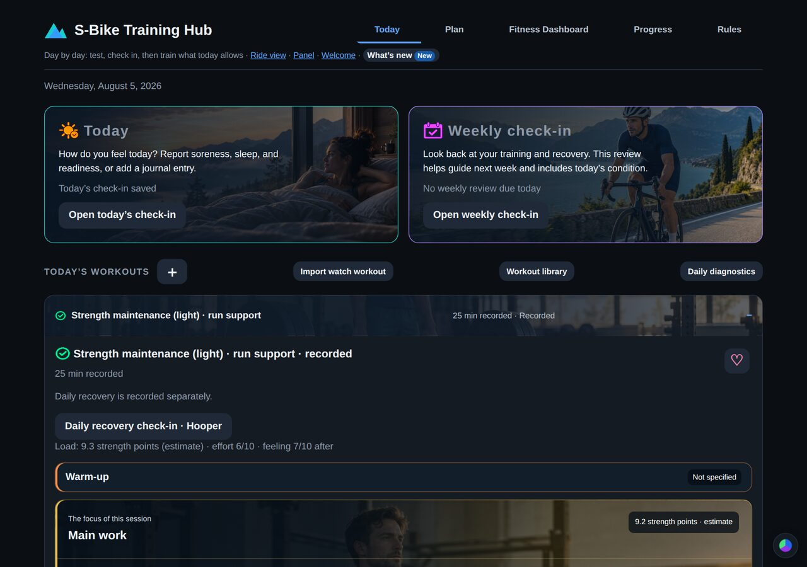
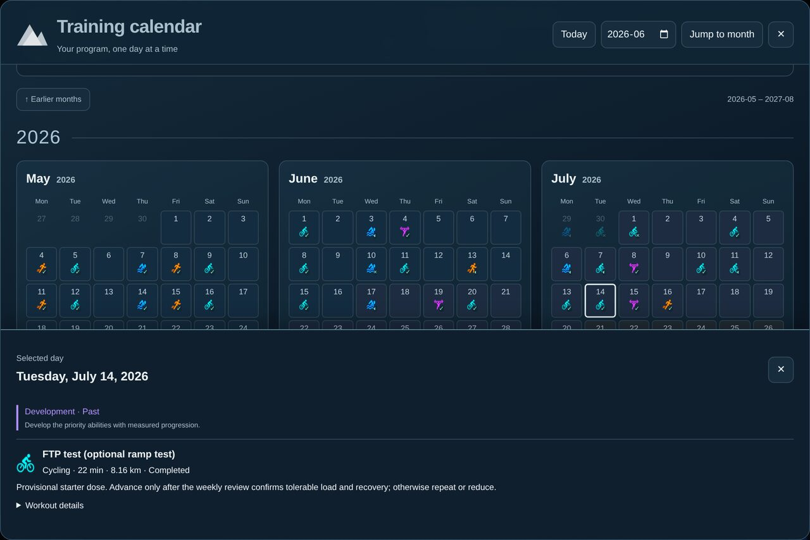
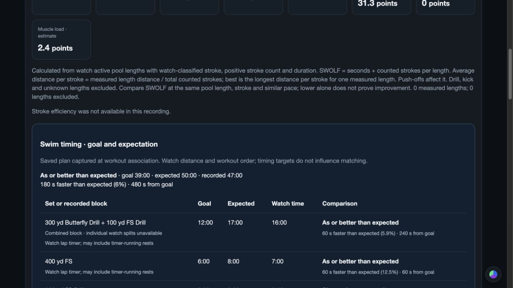
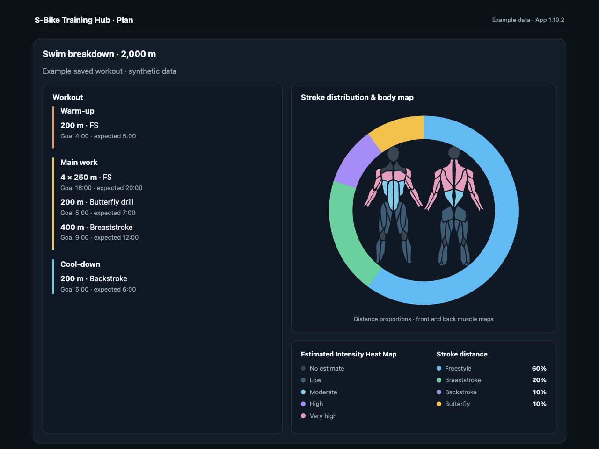
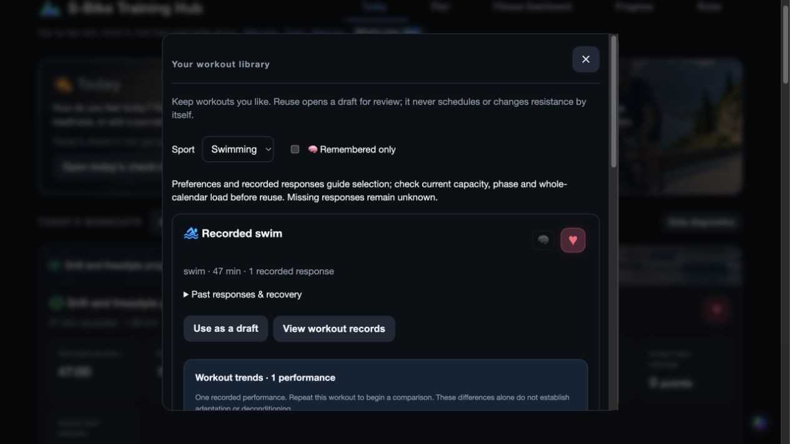
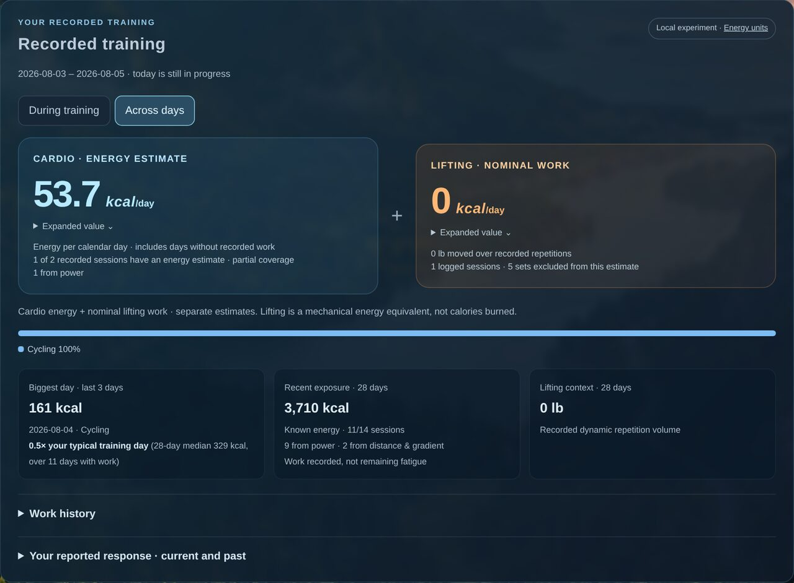
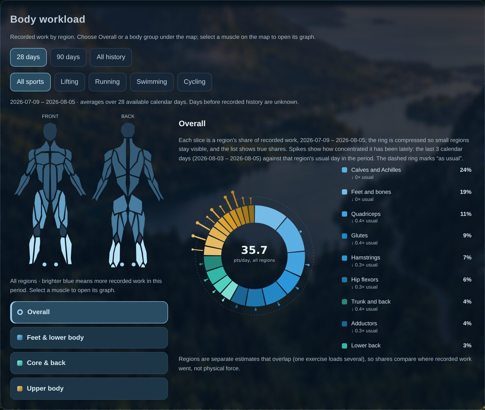

# Using the hub

A tour of the hub's pages and features. To install it, see the [README](../README.md). For the models and formulas behind the numbers, see [how it works](how-it-works.md). For what changed when, see the [changelog](../CHANGELOG.md).

- [Today](#today)
- [Plan and the training calendar](#plan-and-the-training-calendar)
- [Events](#events)
- [Writing and importing workouts](#writing-and-importing-workouts)
- [Getting recorded training in](#getting-recorded-training-in)
- [Fitness Dashboard](#fitness-dashboard)
- [Missed work and plan changes](#missed-work-and-plan-changes)
- [Rules](#rules)
- [Riding](#riding)
- [Personal music and video](#personal-music-and-video)
- [Updates](#updates)

## Today

**Today** is the daily page:
- **The daily check-in:** soreness, sleep and readiness (the Hooper questionnaire), pain by body site, and an optional journal line.
- **The weekly check-in:** a look back at the week, including the weekly overuse questionnaire (OSTRC).
- **Today's workouts:** each card shows the warm-up, main work and cool-down. The pencil on an unfinished workout reopens it for editing; completed workouts keep their original record.
- **After a workout:** report how it went (effort on the CR-10 scale; for lifting, **Too easy**, **As intended** or **Too hard**). The report stays linked to the workout.

Today follows your computer's date. At midnight it waits until open editors and dialogs are closed, so nothing unsaved is lost.

## Plan and the training calendar

**Plan** shows your goal, available time, sport priorities and the program's phases (for example assessment week, foundation, development, event preparation, final preparation). **Revise / preview program** drafts changes that you review before anything is saved.

Each workout in Plan explains its purpose, its phase and how it fits with the sessions around it. Test workouts explain what they measure, how they run and what to record afterward.

The **training calendar** shows the whole program, three months per row:

- Each day shows its sessions as sport icons, marked ✓ completed, partial, × missed or – cancelled.
- Phases are colored; turn **Phase colors** off for a plain view.
- **Jump to month** and **Today** move around; **Earlier months** loads history.
- Click a day for its details:

**Plan → Plan follow-through** separates completed, partial, cancelled and missed sessions from changes made to the plan. Cancelled work still counts in the completion rate. Changes keep the before and after.

The **plan load outlook** shows recorded and projected load through the plan against each phase's target (for example a recovery week at about 50–60% of your usual rate). It describes and flags; you and your assistant decide.

## Events

Add an event as an optional goal:
- by hand;
- from an event-directory link;
- from a public event page: the hub pulls out the details (name, date, distance) and shows them for review. Missing or unclear fields need your answer before anything is saved.

Organizer artwork appears only after you confirm you have permission. Removing an event leaves its training schedule in place.

## Writing and importing workouts

Use **＋** next to Today's workouts, or **Add workout**, then pick a sport. Every sport has a live preview that doesn't need an AI assistant.

### Cycling

Type the workout into its text fields; the effort graph updates as you type. Goals can include time, an average-power range (for the main work or the whole session), distance and energy. Average power is weighted by duration.

A power prescription can't confirm road distance or calories burned, so those goals stay marked unresolved until there's a model or a recording that can answer them.

### Running

Choose **Run / walk**, **Steady run / jog** or **Speed intervals**, then enter stages such as `6 x (2 minutes jog zone 2 / 1 minute walk)`. The order of the stages is kept. Optional targets: distance, steps, a watch heart-rate zone or a heart-rate range.

Distance-only stages need a time or pace to estimate steps. When an assumed cadence is used, it's labeled.

### Swimming

Write the warm-up, drills, named main sets and cool-down. The preview totals yards or meters and keeps repetitions, strokes, equipment, send-offs and fixed rest:
- `6 × 50 kick @ 1:10` starts a 50 every 70 seconds. It doesn't mean 70 seconds of rest.
- `rest 20 seconds` means rest.
- `400 FS 6 to 8 minutes` stores a 6-minute goal and an 8-minute expected time for that set. A single time sets both.

After you link the watch file, sets are matched by distance and order, and each one shows **at goal**, **as or better than expected** or **slower than expected**. Drills the watch can't tell apart stay one block. Missing, extra or unclear segments are shown for review; no split times are made up.

Optional drill times you remember are stored as your report, separate from the watch. For sets without times, after three comparable swims the builder offers a draft based on your recent best and median, for you to accept or not.

Plan's swim details show the workout beside a stroke-distance donut on the body map:

### Strength

Write the exercises with sets, reps and weight (or hold seconds). An optional goal for **total weight moved** is checked against the preview: sets × reps × weight, both sides counted for single-arm or single-leg sets. Static holds and body weight aren't included in weight moved.

Holds count as time under load: every 3 seconds held counts as another rep at that weight. A set taken to failure counts as your limit for strength estimates.

### Importing a written workout

**Import workout file** reads images, screenshots, PDFs (up to six pages), and text or Markdown. Text recognition runs on your computer. The original is kept, and the recognized text fills the workout fields for you to check against **View original** before pressing **Continue**. Handwriting may need corrections. Imports are drafts, not completed workouts.

[GoSwimFast's training hub](https://goswimfast.com/training) has a swim workout library and generator that the hub's creator uses for structured swims. It's an independent recommendation, not an integration or partnership. Import a workout you're allowed to use, then check it against your own program and condition.

### Goals without a workout, and the library

- **Save goal brief without a workout** saves a dated request for your coach or assistant to design or reuse a fitting session. It adds no load.
- **Save for later** puts a workout in your library (red heart) without scheduling it.
- Library entries show your effort reports, the original completion record, and delayed recovery feedback when there is some. Missing feedback shows as unknown.
- A strength routine keeps its history when only weight or reps change; different exercises make a different routine.

## Getting recorded training in

- **Watch files:** **Import watch workout** on Today takes `.fit` or `.tcx` files (COROS, Garmin and other watches). Pick the scheduled workout it belongs to, or **＋ New workout**. Preview the link before saving. Duplicates are detected.
- **Bike and watch together:** a watch file can be linked to a hub bike recording. Bike power and cadence and watch heart rate are lined up (with an optional clock adjustment) and counted as one session.
- **Through your assistant:** with a watch connector (for example COROS), ask *"put my latest workout into the hub"*. The assistant uses the same review and save steps.

## Fitness Dashboard

**Recorded training:** energy per day and during training, the biggest day of the last three against your typical training day, and the 28-day total.

- Energy comes from the most reliable source available: bike power, then distance and gradient for runs and walks, then the watch.
- **Settings → Training display → Energy units** switches between calories and joules/watts. One kcal = 4,184 J; 1 kcal/min ≈ 69.73 W.
- Lifting shows **nominal work** (an estimate of external work), which is not calories burned.

**Body workload:** where recorded work went, region by region, over 28 days, 90 days or all history, for all sports or one. Select a muscle on the map to open its graph.

**Sport training history:** switch between lifting, swimming, cycling and running.
- Lifting: benchmark lifts, session-to-session comparisons (estimated work in kJ or lb × reps), and saved strength estimates.
- Swimming: stroke distance by session, day, month, quarter or phase, and planned against what the watch detected.
- Running and cycling: weekly totals and session readings.

**Calibration & tests:** test results and watch measurements.

## Missed work and plan changes

- **Cancel (✕)** keeps the workout with a red X. It adds no planned load and can be restored.
- A finished day with no recorded training also shows **Recovery day · no training recorded**. That describes the record, not how recovered you are.
- When a session is missed, the hub (or your assistant) asks why: busy, sick, sore… The next week is planned around what happened.

## Rules

Plain sentences that steer every workout, for example *"I can't do pull ups"*, *"No barbell deadlifts"*, *"No barbell work the day before a long ride"*:
- An excluded lift is swapped for the next option, never dropped.
- An equipment word narrows a rule: "No barbell deadlifts" still allows dumbbell Romanian deadlifts.
- Every assistant reads your rules, and a plan that breaks a "no…" or "never…" rule is refused.

## Riding

**Ride view** keeps Today, the plan, Plan a ride, Fitness, Progress and Settings within reach. From the **Ride menu**, choose:
- real 3D maps;
- the animal game, or its 8-bit version;
- the 3D haunted graveyard;
- your own videos.

Check **Default** to remember your choice in this browser. Changing the view keeps the workout or route running; the workout's watts or the route's grades still drive the bike. On a phone, the layout has a compact cadence display.

**Plan a ride:** save or import a route, choose **Show**, pick a date and a planned duration, then **Add route to training plan**. Its load counts toward the plan. Route time is a target, not a promise.

The graveyard is a winding course with crypts, moonlit woods and ghosts, built from Kenney's Graveyard Kit and rendered with Three.js on your computer. **Explore scenery** tours it without starting a workout.

## Personal music and video

One **private folder on your computer** supplies music and video for rides. Set it in **Settings → Music connections** (on Linux and Windows, set `HUB_MUSIC_FOLDER`). The library shows audio and video separately, with search, random picks, cover art and tempo where available. Uploads never overwrite existing files. Setup works only on the computer running the hub; paired devices can play the media. The hub doesn't convert formats, so what plays depends on the browser. Details: [personal media](PERSONAL-MEDIA.md).

## Updates

**What's new** in the Coach header lists dated releases. **Check for updates** reads the public update list on GitHub. Automatic checks are optional, run at most twice a day, send no athlete data and never install anything.
