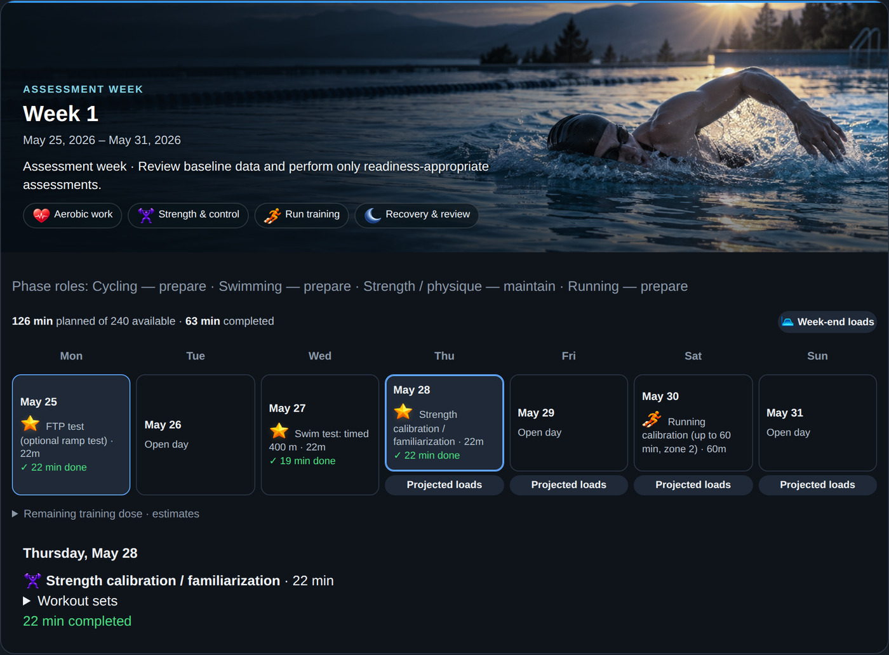
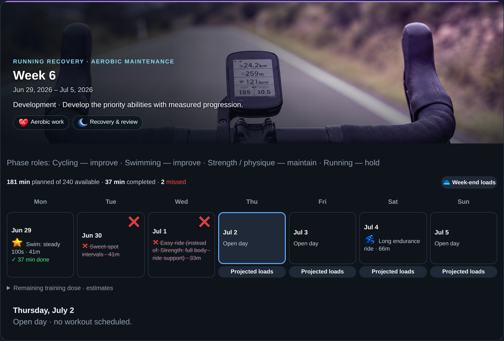
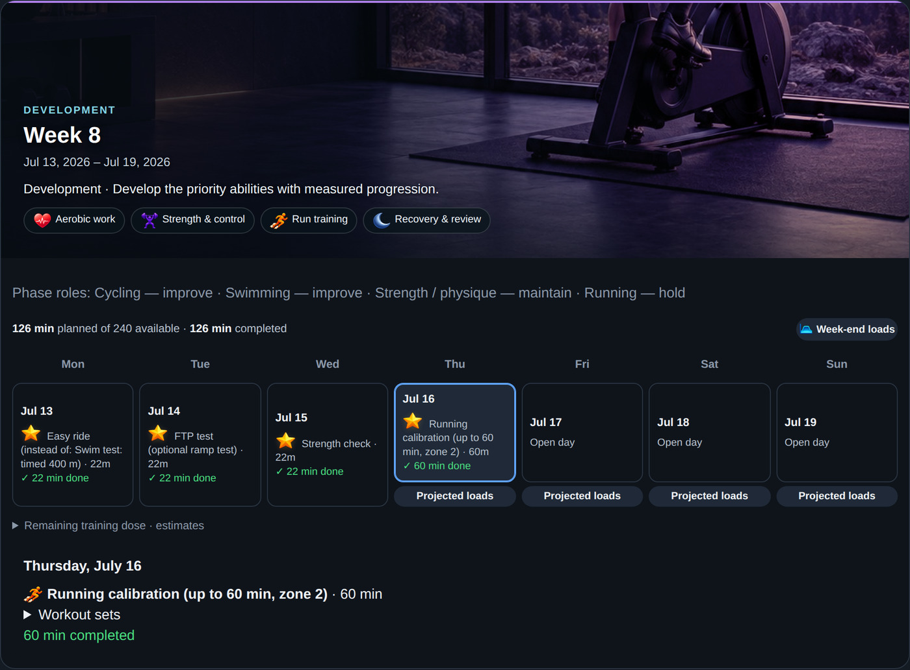
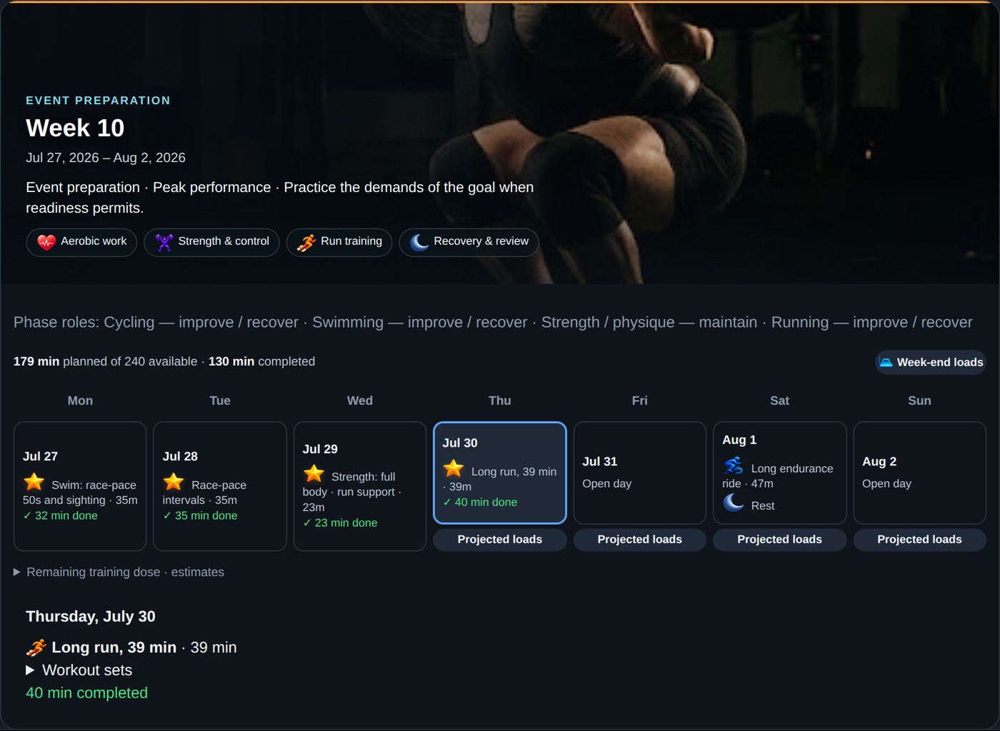
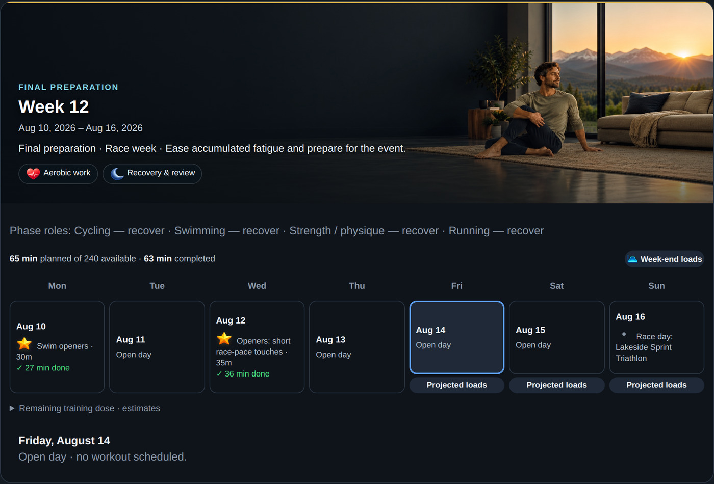
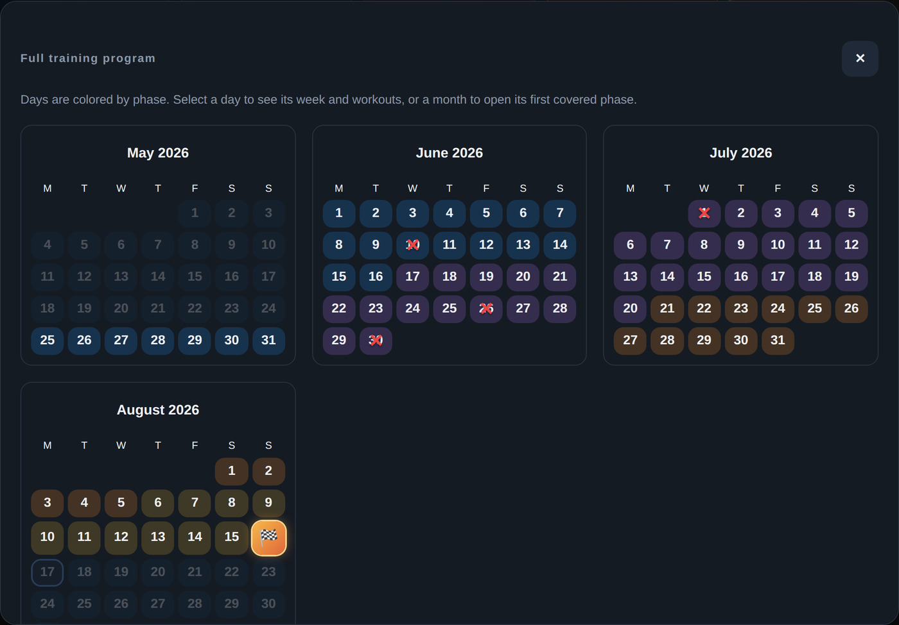

# A 12-week program, day by day

> **Recorded on 2026-10-03 with an earlier version (MCP 1.5).** The screens have been redesigned since, and running then used the *block model*, which the hub has moved away from (see [how it works](how-it-works.md#status-of-the-models)). The program structure (test week, check weeks, phases, race week) is still how programs are built. For current screens, see the [user guide](guide.md).

Meet Jordan: a fictional 36-year-old training four hours a week for a first sprint triathlon. Everything below is the real hub, run day by day with a simulated athlete:
- watch files for every session;
- morning check-ins;
- run reports;
- a busy day, a head cold, a sore shin and a pinching shoulder.

Nothing on these screens was drawn by hand; it's what the hub calculated.

**Week 1 is a test week:**
- an FTP ramp test;
- a timed swim;
- a strength familiarization;
- the **running calibration**: up to an hour in zone 2.

Jordan stopped at 40 minutes, tired, and said so. After eight days without running and with clean mornings, the hub set the running block from that run. The program starts well below Jordan's four hours, because available time is a ceiling to grow into, not a starting dose.

**Week 6: life happens.**
- **Missed sessions:** a red ✕ and a reason (busy, sick, sore…).
- **The shin:** after Jordan reported a sore shin, running went on hold and then came back in gradually. The assistant swapped the affected sessions and said why.

**Week 8: a check week.** A deload that retests everything: FTP, a strength check (one comfortable set per lift), and a full-hour running calibration. Jordan is fitter now, so the running block was re-measured bigger. A 12-week program gets two check weeks, a 16-week one three, and a year eight, the last three close together before the peak.

**Week 10: event preparation.** A different shape from the volume peak: race-pace swim and ride intervals, a long run, and bricks (a run straight off the bike).

**Week 12: race week.** Short openers, quiet days, and race day on the calendar.

To make your own copy of this journey: `python3 tools/demo/journey.py` (Linux, needs `faketime` and Playwright; `--from week06` replays from a save point).
